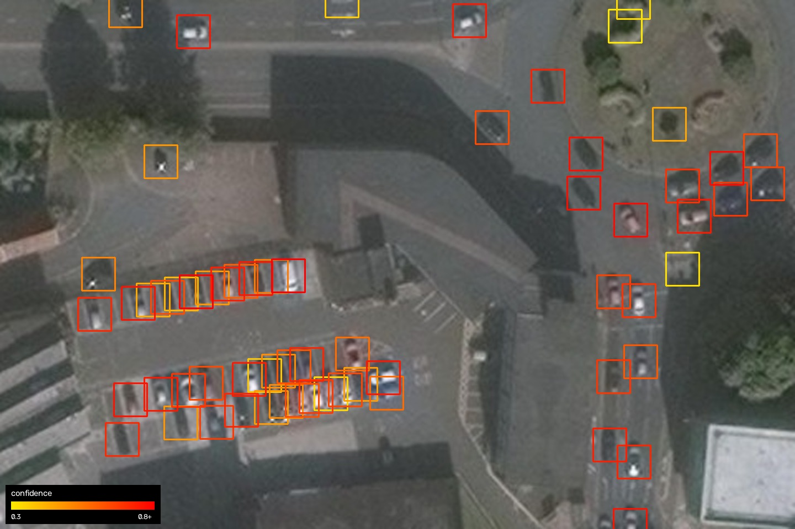
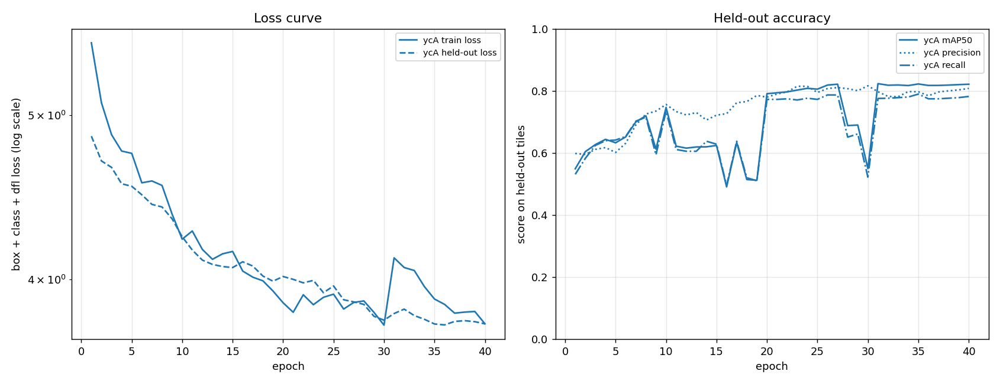
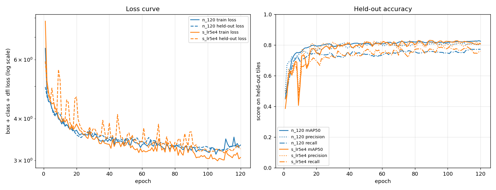
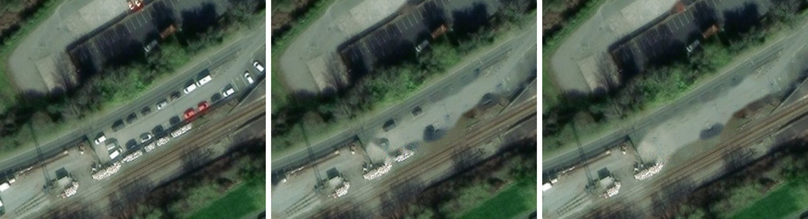

# aerial-car-detector

A **fine-tuned YOLO11n** detector (2.6 million parameters, a 5.7 MB weights file) for **cars in 25 cm aerial photos**, built to paint
parked cars out of aerial imagery.



Detections (confidence 0.3 or more) from the nano model on a crop of Norwich, a town it never trained on. Boxes run from
yellow (just over the 0.3 cutoff) to red (0.8 or more confident) and are a fixed 20 px (5 m) square on each car's centre,
so packed bays overlap. A few misses and false hits remain (bushes near the roundabout, a bin store at the right), mostly
the yellow and orange boxes.

## What we found

Cars are ~18 x 7 px in our 25 cm imagery. On a Newtown crop with ~150 cars:

| Detector | Found |
|---|---|
| Pretrained DOTA `yolov8n-obb` / `yolo11n-obb` | 0 to 12 |
| Colour blobs (`cardet/blobs.py`) | most red/white cars, many false boxes |
| VHR-10 `yolov8n` ([bluelabel](https://huggingface.co/bluelabel/satellite-equipment-detection-yolov8n-vhr10)) | 30 at best, upscaled 3x |
| OWLv2 (public Space, "a photo of a car", 2x) | most cars, many duplicates and false boxes; not pursued |
| **`yolo11n` [wuhp/yolocar](https://huggingface.co/wuhp/yolocar)** (5.5 MB) | 100 at conf 0.3, 121 at 0.2, upscaled 2x; roughly half to two thirds of cars, few false boxes |

COWC (the usual aerial car dataset) was checked and set aside: its downloads are classification patches or one point
per car, not boxes.

## Model tuning

### Data

40 tiles of 768 px (0.25 m per pixel), 3,721 cars, corrected by hand in the labelling page. `yolocar`'s boxes were the
starting point; 60% of the final cars (2,224) had to be added by hand, so its boxes covered about 40% of the cars once
false ones were deleted.

| Area | Tiles | Cars |
|---|---|---|
| Newtown (`t`) | 16 | 1,230 |
| Bath (`b`) | 12 | 1,197 |
| Shrewsbury (`e`) | 6 | 984 |
| Porthmadog (`w`) | 6 | 310 |

Held out for testing: `t03 t08 b03 b06 e03 w01` (6 tiles, 527 cars, all four areas). The other 34 tiles (3,194 cars)
train the model. Labels and tile origins are in `labels/newtown/`; the tile images are cut again from the source
bundle (imagery, building footprints and a `meta.json`) by `cardet.prepare`.

Every car is turned into a fixed 20 px square on its centre (`cardet/dataset.py`): the hand-made boxes are tight and
angled, the detector's loose and upright, so only the centre is trusted. Tiles are enlarged 2x (1536 px) because
detectors do much better on bigger cars. Each training tile also appears turned 90 degrees, and Ultralytics flips
left-right and up-down, so every tile is seen in all 8 orientations. Free-angle rotation is off: it would grow the boxes.

### Training

| | |
|---|---|
| Start from | `yolocar` (YOLO11n architecture, 5.5 MB), one class |
| Epochs / image size / batch | 40 / 1536 px / 2 |
| Optimiser | AdamW, learning rate 0.0005 |
| Augmentation | flips, 90 degree copies, Ultralytics defaults (mosaic, colour, scale, shift) |
| Hardware | Apple GPU (MPS), about 2 h 10 min wall clock with 4 crash/resume cycles |
| Result | `runs/detect/runs/ycA/weights/best.pt` (5.7 MB, not committed) |

Command: `python3 -m cardet.dataset data/newtown data/yolo` then
`python3 -m cardet.train data/yolo data/models/yolocar-11n.pt name=ycA epochs=40 lr0=0.0005`.
On the Apple GPU Ultralytics randomly crashes with a shape-mismatch error in its label assigner (epochs 20, 21, 31, 38
here, never the same place). `python3 -m cardet.train resume <last.pt>` carries on from the last full epoch, so nothing
is lost. It is not a data problem, and a CUDA GPU should not hit it (cause not confirmed).



Left, the loss curve (log scale): training and held-out loss fall together from about 5.5 to 3.8, with no sign of
overfitting. Right, held-out precision, recall and mAP50 per epoch. The dips (epochs 9, 16, 19, 28 to 30) are mostly
validation noise at a high learning rate and just after restarts; the curve is flat from epoch 31 and ends at mAP50
0.82 (best epoch 31; mAP50-95 0.415).

### Score on the 527 held-out cars

A detection is right if its centre is within 2 m (8 px) of a labelled car; buildings are masked; each car is matched once
(`python3 -m cardet.score data/newtown <weights>`).

| Confidence | `yolocar` as downloaded: precision / recall / F1 | Fine-tuned (`ycA`): precision / recall / F1 |
|---|---|---|
| 0.1 | 0.83 / 0.61 / 0.70 | 0.70 / 0.84 / 0.76 |
| 0.2 | 0.89 / 0.50 / 0.64 | 0.80 / 0.81 / **0.81** |
| 0.3 | 0.91 / 0.40 / 0.56 | 0.87 / 0.76 / **0.81** |
| 0.4 | 0.93 / 0.33 / 0.49 | 0.91 / 0.67 / 0.77 |
| 0.5 | 0.96 / 0.25 / 0.39 | 0.94 / 0.54 / 0.69 |

Best F1 goes from 0.70 to 0.81. At about the same precision (0.80 vs 0.83) recall rises from 0.61 to 0.81.

### Round 2: 6,792 cars from 12 places, trained on a cloud GPU

72 tiles (Newtown, Bath, Shrewsbury, Porthmadog, plus Bristol, Cardiff, Manchester, Edinburgh, Swindon, Leeds, Brighton and
Aberystwyth), 6,792 labelled cars, large vehicles at their real size. Held out: 14 tiles, 1,381 cars (the original six plus
one tile from each of the eight newer places). Runs on a Colab T4 (`cloud/train.ipynb`; 116 training images, 6 s per
epoch for the nano model). Scored with the same 2 m match, best F1 over confidence 0.1 to 0.5:

| Model | Epochs | Original six tiles (527 cars) | Eight new-place tiles (854 cars) | All 14 |
|---|---|---|---|---|
| round 1 fine-tune (`ycA`-style, 3,194 cars) | 60 | 0.81 | **0.85** (see caveat) | **0.81** |
| nano, lr 0.0005 (`n_120`) | 120 | 0.85 | 0.77 | 0.80 |
| nano, other seed (`n_seed1`) | 120 | n/a | n/a | 0.80 |
| nano, lr 0.001 (`n_lr1e3`) | 120 | 0.85 | 0.78 | 0.80 |
| nano, 1920 px input (`n_img1920`) | 120 | n/a | n/a | 0.80 |
| small, lr 0.0005 (`s_lr5e4`, 19 MB) | 120 | **0.87** | 0.78 | 0.81 |



**Clean tiles (Norwich, Plymouth: 4 tiles, 223 cars), best F1 over confidence 0.1 to 0.5**

| Model | Best F1 | Precision / recall there |
|---|---|---|
| `yolocar` as downloaded | 0.78 (flattered: the boxes began from it) | 0.89 / 0.70 at conf 0.1 |
| round 1 fine-tune | 0.72 | 0.76 / 0.68 at conf 0.2 |
| nano `n_120` | 0.74 | 0.83 / 0.67 at conf 0.4 |
| nano `n_lr1e3` | 0.77 | 0.84 / 0.71 at conf 0.4 |
| small `s_lr5e4` | 0.73 | 0.83 / 0.65 at conf 0.4 |

On towns none of the models saw, every fine-tune lands around 0.72 to 0.77, well below the 0.85 to 0.87 on the original
six tiles. The truth boxes began from the downloaded `yolocar`, so its row is inflated, and four tiles of 223 cars give
differences of a few points that mean nothing. Honest reading: the fine-tuned models are not shown to generalise better
than the downloaded one, and the real accuracy in a new town is about 0.75, not 0.85.

- On the six tiles that were never part of any labelling-by-detector, the new data helps: 0.81 to 0.85 (nano) and 0.87
  (small). The small model is the one to use.
- The "new place" column is biased towards round 1: its boxes were drawn by the round 1 model and then corrected, so cars
  it found are in the truth set and cars it missed are less likely to be. Read that column as "round 1 marked against its
  own homework". `x01`, `x02` (Norwich) and `y01`, `y02` (Plymouth) were pre-drawn by the plain downloaded `yolocar`
  instead, are never trained on (`CLEAN_TILES`), and are scored apart with `python3 -m cardet.score data/newtown <weights> clean`.
- Run to run noise is about 0.002 F1 (two seeds), so lr 0.001 and 1920 px input changed nothing real.
- The medium COCO model ran out of GPU memory at batch 8 on the T4 and was dropped. Small from COCO at lr 0.002 collapsed
  between epochs 5 and 10 (learning rate too high); at 0.0005 it trains smoothly.

### Earlier attempts (first 8 Newtown tiles only; 543 train cars, 136 held out, all Newtown)

| Weights | Best F1 |
|---|---|
| `yolocar` as downloaded | 0.80 (flattered: those labels began from its boxes) |
| `yolocar` fine-tuned, lr 0.002, 60 epochs | 0.75 |
| `yolocar` fine-tuned, backbone frozen, lr 0.0003, 30 epochs | 0.77 |
| standard `yolo11n` (COCO) fine-tuned | 0.68 |
| standard `yolo11s` (COCO) fine-tuned | 0.75 |

543 cars was not enough to beat the downloaded model. With 3,194 it is clearly better. A COCO `yolo11s` run on the full
data crashed at epoch 4 on the Apple GPU (about 4 min per epoch) and was dropped; it is worth running on a cloud GPU.

### Caveats

- The round 1 test tiles come from the same four areas as the training tiles (different tiles, same streets and imagery
  style), so that score says little about places never seen. Round 2 adds eight places, but their truth was drawn from
  round 1 boxes (see above); the Norwich and Plymouth tiles are the clean test.
- Labels are only as complete as the labelling was; a few real cars are unlabelled, which lowers measured precision.
- Cars cut by the edge of a tile are labelled as clipped boxes; `detect.py` drops half-cars at inner window edges.

### Next: broader, not deeper

The clean-tile score (about 0.75 in unseen towns against 0.85 to 0.87 near the training places) suggests more places will
help more than more epochs or a bigger model: the imagery varies a lot by town and capture date (Plymouth is dark and
soft, Newtown crisp), so the model has seen too few kinds of picture. Not started. Plan: one or two tiles from each of
20 or so towns spread across the UK (Glasgow, Belfast, Birmingham, Liverpool, Newcastle, Sheffield, Nottingham, Leicester,
Oxford, Cambridge, Exeter, Southampton, Inverness, Carlisle, Hull, Ipswich and so on), whole towns held out so the test
measures new places, and the nano model (`data/models/yolocar-nano-v2.pt`, the `n_lr1e3` run, about 6 MB) as the detector
that pre-draws the boxes. For now the nano model is the one we use: it scores the same as the 19 MB small model in unseen
towns.

## Plan



Vehicle removal on a Newtown station road, left to right: the original imagery; cars removed using the downloaded
`yolocar` model's detections; cars removed using this project's fine-tuned nano model's detections. In both, the
detected cars are masked and painted out with OpenCV's Telea inpainting, then given grain matched to the surrounding
tarmac (`cardet/fill.py`). Only the detector differs, so the difference between the two right-hand panels is how many
cars each one found.

1. Run the detector at 2x (`cardet/detect.py`), buildings masked, confidence about 0.2 to 0.3 with the fine-tuned weights
2. Fill the cars out of the imagery (`cardet/fill.py`, `python3 -m cardet.clean`); before and after for the downloaded
   model: `docs/before-after-centre.jpg`, `docs/before-after-station.jpg`
3. Re-clean Newtown with the fine-tuned weights and compare (done, confidence 0.25): 1,552 cars painted out against 1,075
   with the downloaded model, and the leftover dark and shadowed cars in the car parks and the station road are gone.
   `docs/compare-centre.jpg`, `docs/compare-station.jpg`: original, downloaded model, fine-tuned (left to right). Soft
   dark patches remain where shadows were filled, and some rail wagons are still partly removed
4. Publish the weights (done: release `v0.1.0`, and inside the package since `v0.2.0`)

The nano model ships inside the package: `cardet/models/aerial-car-nano.pt` (5.7 MB, the `n_lr1e3` run; also attached to
release `v0.1.0`). Install the library and remove cars from an image with one call:

```
pip install git+https://github.com/sergiomarrocoli/aerial-car-detector.git@v0.2.0
```
```python
from cardet.api import remove_cars
cleaned, boxes = remove_cars(rgb, buildings=mask)    # rgb: 25 cm/px uint8 array; mask: optional building footprints
```

Or from the command line, `python3 -m cardet.clean <bundle> --weights cardet/models/aerial-car-nano.pt --out clean.jpg`.
Other weights, `data/` and `runs/` are not committed. Fetch `yolocar` with
`curl -L -o data/models/yolocar-11n.pt https://huggingface.co/wuhp/yolocar/resolve/main/car-75e-11n.pt`.

## More places

`python3 -m cardet.fetch_area data/areas norwich plymouth` fetches a 1 km box of Esri imagery (resampled to 0.25 m/px) and
OpenStreetMap buildings for named places (Bristol, Cardiff, Manchester, Edinburgh, Swindon, Leeds, Brighton, Aberystwyth,
plus Norwich and Plymouth kept for the clean test; `--at LAT LON name` fetches anywhere) and writes a small bundle
that `cardet.prepare` cuts into tiles, pre-labelled by the current best weights. Where the model fails: per-tile
scores on the held-out set showed dense city streets with buses and shadows (Bath `b03` F1 0.59, Shrewsbury `e03` 0.72)
are much worse than Newtown (0.83 to 0.87), so new tiles lean towards those. Vehicles over 28 px (buses, lorries) now keep
their real size in training instead of the fixed 20 px box, and the detector keeps boxes up to 75 px.

## Hand-labelling tiles

```
python3 -m cardet.prepare path/to/bundle --out data/newtown --weights data/models/yolocar-11n.pt [--prefix b --count 12 --skip 0]
python3 -m cardet.labeller data/newtown        # http://127.0.0.1:8790
```

Boxes run from yellow (weak) to red (confident). Click a box to delete it, click empty ground to add a car, drag along
a car to add it pointing the right way. "Drop N weak" removes every dashed box under the confidence you set. Press D
when every car in a tile has a box. Omit `--weights` to pre-draw with the colour-blob finder instead.

## Setup

```
python3 -m venv .venv && .venv/bin/pip install -r requirements.txt
.venv/bin/python -m pytest
```

## Image credits

The aerial screenshots in `docs/` are crops of Esri World Imagery, shown for illustration only. Imagery © Esri, Maxar,
Earthstar Geographics and the GIS User Community. This repository does not include the source imagery;
`cardet.fetch_area` downloads it for you, subject to
[Esri's terms of use](https://www.esri.com/en-us/legal/terms/full-master-agreement).
